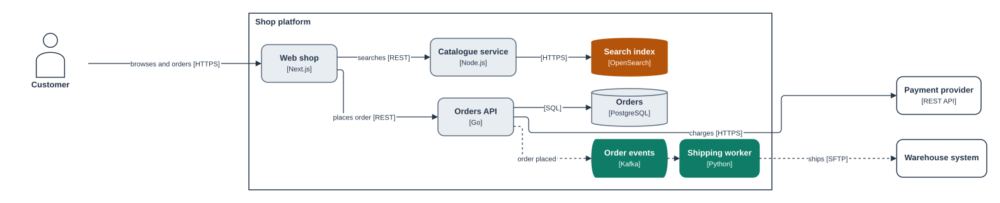
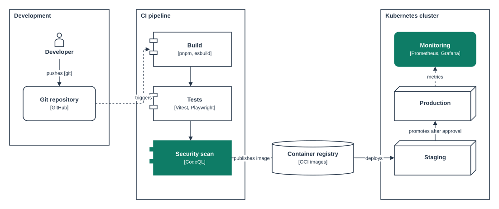
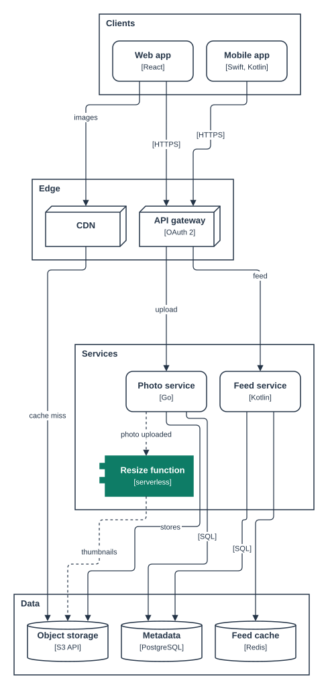
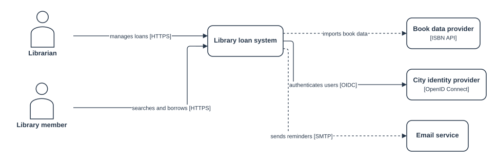
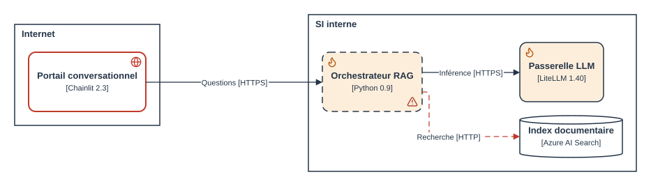
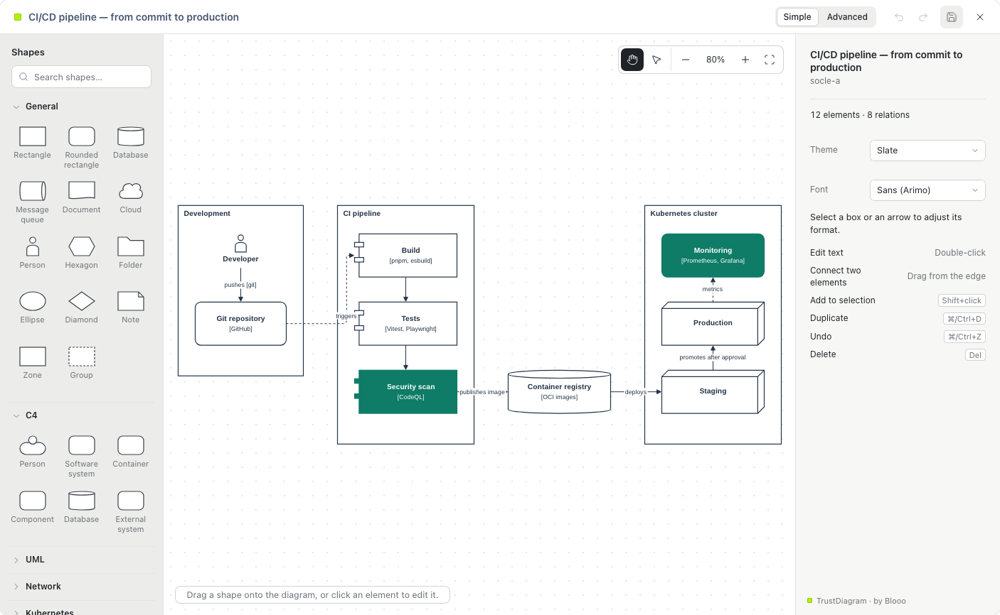

# TrustDiagram

**Architecture diagrams as code. Never trust a drawing. Always verify the model.**

TrustDiagram turns a short YAML block into an architecture diagram, in Obsidian and in Confluence. The block is the single source of truth. Code checks every box and every arrow before anything is drawn, so no diagram shows what the model does not say.

Free to use, by [Blooo](https://blooo.io). This plugin is closed source.



*Rendered from [`examples/online-shop.trustdiagram.yaml`](examples/online-shop.trustdiagram.yaml): no position written by hand, everything placed and checked by code.*

## Why

A drawing can say anything. Boxes get copied, arrows point to systems that were renamed long ago, and nobody can tell what is real. In a review, a diagram should be evidence, not a promise.

TrustDiagram applies Blooo's principle, *never trust, always verify*, to diagrams:

- **Verified by code.** Each block is checked against a published JSON Schema, then against semantic rules: every arrow must join two declared elements, ids are unique, classes and layers exist. An error stops the rendering and points to the line.
- **Never imagined.** Everything drawn comes from the model. An LLM, or a person, cannot add a box that the model does not declare: the validator rejects it.
- **Meaning and drawing kept apart.** `model` holds the meaning (elements, relations, protocols, data). `layout` holds the positions. Moving a box with the mouse rewrites `layout` only, never the meaning.
- **One rendering everywhere.** Same code, same embedded fonts, same picture in Obsidian, in Confluence and in the CLI.
- **Readable by LLMs.** Plain YAML that a model can read, answer questions about, and write. What it writes is then checked like anything else.

## What it looks like

````markdown
```trustdiagram
trustdiagram: 1
id: payments-containers
title: Payments — containers
kind: flow
model:
  elements:
    - { id: web, type: container, name: Web app, tech: React }
    - { id: api, type: container, name: Payments API, tech: Go }
    - { id: db, type: datastore, name: Ledger, tech: PostgreSQL }
  relations:
    - { id: r1, from: web, to: api, label: pays, protocol: HTTPS, mode: sync }
    - { id: r2, from: api, to: db, protocol: SQL }
```
````

Without a `layout`, elements are placed automatically. Move them with the mouse and only `layout` is written back to the block.

## More examples

| Fully placed by hand | Placed automatically, top to bottom |
|---|---|
|  |  |
| [`ci-cd-pipeline`](examples/ci-cd-pipeline.trustdiagram.yaml) | [`photo-sharing`](examples/photo-sharing.trustdiagram.yaml) |

| System context (C4 level 1) | Display rules |
|---|---|
|  |  |
| [`library-context`](examples/library-context.trustdiagram.yaml) | [`regles`](examples/regles.trustdiagram.yaml) |

## Features



- **Obsidian plugin**: renders `trustdiagram` code blocks in notes, with a full-screen graphical editor and a zoomable viewer.
- **Confluence app** (Atlassian Forge): a macro renders a code block of the page live and edits it with the same editor. Saving rewrites only that block, with version checks, draft protection and a 3-way merge when a colleague changed it meanwhile.
- **Editor**: shape catalogue (general, C4, UML, network, Kubernetes), formatting, layers, alignment, orthogonal routing with line jumps.
- **Data and display rules**: custom properties, reusable classes, `{{key}}` references in labels, "if… then…" rules (colours, stroke, icons), evaluated at every render.
- **Layout verification**: `trustdiagram lint` and the Obsidian commands compute the layout as drawn and report overflowing text, arrows crossing boxes and overlapping labels, each with a fix hint, so an agent can check and correct a diagram in a loop.
- **CLI**: `trustdiagram validate` in CI, `trustdiagram lint` for layout, `trustdiagram render` to SVG or PNG.

## Install

- **Obsidian**: see [apps/obsidian-plugin](apps/obsidian-plugin/README.md). The plugin is being submitted to the community directory.
- **Confluence**: see [apps/forge-app](apps/forge-app/README.md). The app is being prepared for the Atlassian Marketplace.

### Obsidian plugin: what it accesses

- **No network requests.** Fonts and icons are bundled; nothing is sent anywhere.
- **Notes**: it changes a note only when you ask, and only its `trustdiagram` blocks: saving from the editor, *Insert a diagram*, *Pin the layout*, and the two *Recompute the layout* commands (which rewrite `layout` only).
- **Output folder**: the note commands write their results into one vault folder, `_trustdiagram/` by default (set in the plugin settings): *Export* writes an SVG and a PNG per diagram, *Export* and *Check the layout* write a layout report per diagram, and every note command (including *Recompute the layout*) writes a status file for its last run. Nothing else is written outside the notes, and only when you run these commands.
- **Settings**: the output folder name, stored in the plugin's own `data.json`.
- **One external link**: the "TrustDiagram · by Blooo" credit in the viewer and editor opens this repository on GitHub in your browser, only when you click it.
- Desktop only.

## Documentation

- [Format reference](docs/format.md): the full block format, for people and LLMs. Also in [French](docs/format.fr.md).
- [JSON Schema](packages/core/schema/trustdiagram.schema.json).
- [Examples](examples/) and their [renders](examples/renders/).

## Security

Report vulnerabilities privately: see [SECURITY.md](SECURITY.md).

## License

Proprietary, free to use: see [LICENSE](LICENSE). Versions 0.8.0 and earlier were published under the Apache License 2.0. Third-party components keep their own licences: see [NOTICE](NOTICE) and [third-party licenses](docs/LICENSES.md).

---

Made by [Blooo](https://blooo.io): cybersecurity governance and architecture for critical organisations. *Never trust. Always verify.*
